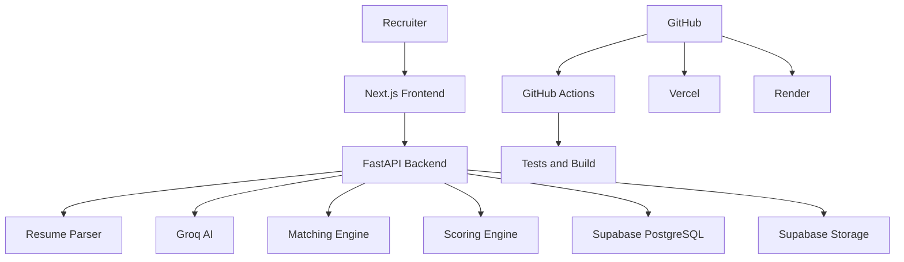
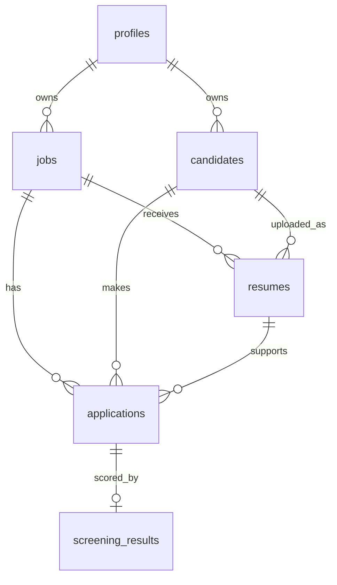
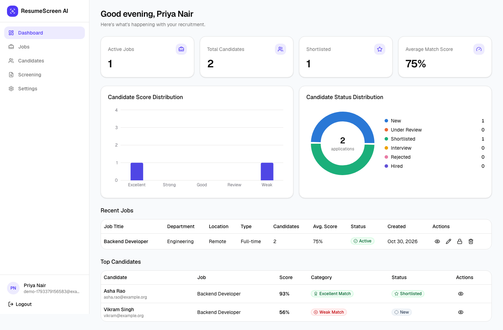
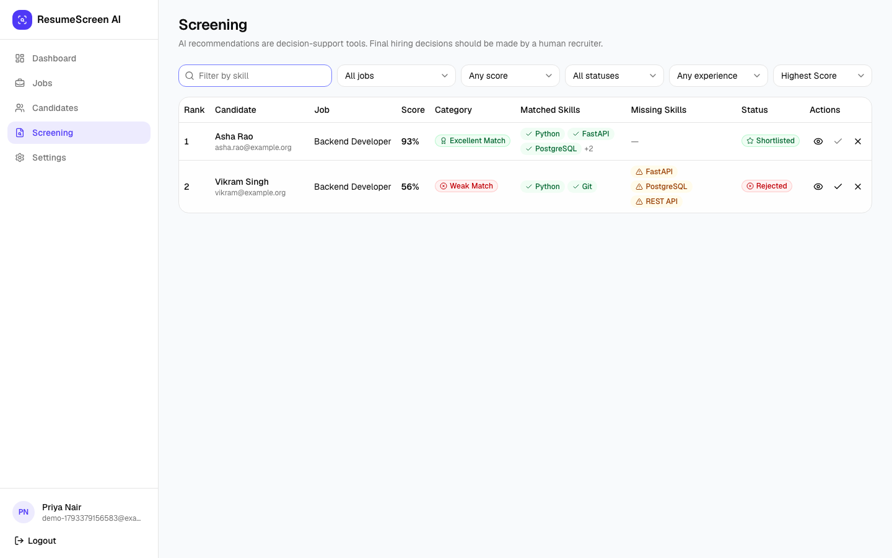

# AI-Based Resume Screening and Candidate Shortlisting System

A full-stack web application that helps a recruiter create jobs, upload resumes, and get an
explainable, ranked shortlist of candidates. Most of each score is calculated by transparent code;
the AI extracts information, explains results, and contributes only 5% of the score.

It runs entirely on free tiers and needs no Docker.

> AI recommendations are decision-support tools. Final hiring decisions should be made by a human
> recruiter.

## Project Details

| Field | Details |
| --- | --- |
| Project No. | P_204 |
| Programme | HCLTech Career Shaper Programme, Industry Project, 2025-26 |
| Learner | Shrishti Yadav |
| College | ABES Engineering College |
| Domain | Artificial Intelligence / Full-Stack Web Development |
| Format | Individual project, 4 weeks |

## Contents

- [Features](#features)
- [Architecture](#architecture)
- [Technology Stack](#technology-stack)
- [Project Structure](#project-structure)
- [Database Schema](#database-schema)
- [AI Workflow](#ai-workflow)
- [Scoring Algorithm](#scoring-algorithm)
- [Local Setup](#local-setup)
- [Testing](#testing)
- [CI/CD](#cicd)
- [Deployment](#deployment)
- [Screenshots](#screenshots)
- [Free-Tier Limitations](#free-tier-limitations)
- [Known Limitations](#known-limitations)
- [Future Improvements](#future-improvements)

The full project report is in [docs/PROJECT_REPORT.md](docs/PROJECT_REPORT.md).

## Features

- Email and password accounts with protected pages
- Job management: create, edit, close, delete, search
- Drag-and-drop upload of several PDF or DOCX resumes (5 MB each)
- AI extraction of candidate details and job requirements
- Hybrid scoring with a full breakdown, matched skills and missing skills
- AI summary, strengths, weaknesses and recommendation for every candidate
- Candidate ranking, filters, search and pagination
- Recruiter status tracking: New, Under Review, Shortlisted, Interview, Rejected, Hired
- Dashboard with live statistics and charts
- CSV export, responsive layout and keyboard-accessible controls

## Architecture



The browser signs in with Supabase Auth and sends its access token to FastAPI. FastAPI checks that
token with Supabase on each request, and every query is limited to the signed-in recruiter's data.
Only the backend holds service credentials.

## Technology Stack

| Area | Technology |
| --- | --- |
| Frontend | Next.js, TypeScript, Tailwind CSS, shadcn/ui, TanStack Query, React Hook Form, Zod, Recharts |
| Backend | Python, FastAPI, Pydantic, SQLAlchemy, Alembic |
| Database, auth, files | Supabase PostgreSQL, Auth and Storage |
| AI | Groq API with `openai/gpt-oss-20b` |
| Resume parsing | PyMuPDF, python-docx |
| Matching | scikit-learn (TF-IDF and cosine similarity) |
| Testing | Pytest, Vitest, Playwright |
| CI/CD | GitHub Actions, Vercel, Render |

## Project Structure

```text
backend/
  app/
    api/        REST routes
    core/       settings, authentication, logging
    db/         SQLAlchemy models and session
    schemas/    Pydantic request and response models
    services/   business logic: parsing, AI, matching, scoring, pipeline, CSV
    utils/      text cleaning and skill normalization
  alembic/      database migrations
  scripts/      seed data and storage setup
  tests/
frontend/
  app/          pages (protected pages sit in the (protected) route group)
  components/   layout, dashboard, jobs, candidates, ui
  hooks/        TanStack Query hooks
  lib/          API client, Supabase client, validation, helpers
  types/
  tests/        Vitest
  e2e/          Playwright
docs/           project report and screenshots
```

## Database Schema



| Table | Purpose |
| --- | --- |
| `profiles` | Recruiters, linked to Supabase Auth |
| `jobs` | Openings, form fields and AI-extracted `structured_requirements` |
| `candidates` | People, unique per recruiter by email |
| `resumes` | File location, extracted text, parsed data and processing status |
| `applications` | One candidate applying to one job, with the recruiter's status |
| `screening_results` | Component scores, skills, AI explanation and recommendation |

Two columns go beyond the original design. `candidates.user_id` makes ownership direct, so one
recruiter's candidates can never appear for another. `resumes.content_hash` recognizes a file that
was already processed, so it is not sent to Groq twice.

Row Level Security is enabled on every table. Supabase exposes the `public` schema through a REST
API that is reachable with the public anon key, so without RLS that key could read the data. The
backend's database role owns the tables and is not affected.

## AI Workflow

1. **Upload.** The file's type, signature and size are checked, and it is stored in a private bucket.
2. **Extract text** with PyMuPDF or python-docx, then clean it.
3. **Extract structure.** Groq returns JSON, validated by the `ResumeData` Pydantic model.
4. **Save** the result immediately, so later failures never repeat this call.
5. **Match and score** with deterministic code.
6. **Evaluate.** Groq receives the requirements, the calculated results and job-related candidate
   data, and returns a 0-100 score, summary, strengths, weaknesses and a recommendation.
7. **Save** the screening result.

Processing runs in FastAPI background tasks while the page polls for progress. Temporary Groq
failures and rate limits are retried with backoff. A failure is recorded on the resume, and
**Re-run Screening** retries it using any data already saved.

**Fairness.** Name, contact details and location are removed before the evaluation prompt. The
prompt forbids considering protected characteristics, and no such attribute is scored. Candidates
are never rejected automatically.

**Untrusted input.** Resumes are treated as data. Prompts tell the model to ignore instructions
inside them, AI scores are clamped, recommendations must be one of four allowed values, links must
be `http` or `https`, and CSV cells are protected against spreadsheet formulas. A hidden instruction
in a resume can affect at most the 5% AI component.

## Scoring Algorithm

```text
overall = skills * 0.35 + experience * 0.20 + semantic * 0.20 + projects * 0.10
        + education * 0.05 + certifications * 0.05 + ai * 0.05
```

| Component | How it is calculated |
| --- | --- |
| Required Skills (35%) | Matched required skills / total required skills × 100, after normalizing names, so `JS` equals `JavaScript` |
| Experience (20%) | Candidate years / required years × 100, capped at 100 |
| Semantic Match (20%) | TF-IDF cosine similarity between candidate and job text |
| Projects (10%) | Share of the job's key terms found in projects; covering half earns full marks |
| Education (5%) | 100 for matching level and field, 70 for one of them, 40 for neither |
| Certifications (5%) | 100 if relevant, otherwise 50 |
| AI Evaluation (5%) | Score from Groq's qualitative review |

Cosine similarity between a resume and a job description rarely passes about 0.5 even for an
excellent fit, so 0.5 is treated as a full match (`SEMANTIC_FULL_MATCH`). Without this, a perfect
candidate would be unable to reach the top categories.

| Score | Category |
| --- | --- |
| 90-100 | Excellent Match |
| 80-89 | Strong Match |
| 70-79 | Good Match |
| 60-69 | Review |
| 0-59 | Weak Match |

What the recruiter types on the job form always takes priority over what the AI inferred from the
description.

## Local Setup

You need Node.js 22 or newer, Python 3.13, a free Supabase project and a free Groq API key.

### Environment Variables

```bash
cp backend/.env.example backend/.env
cp frontend/.env.example frontend/.env.local
```

**Backend** (`backend/.env`)

| Variable | Value |
| --- | --- |
| `DATABASE_URL` | Supabase Session pooler connection string |
| `SUPABASE_URL` | Project URL |
| `SUPABASE_SERVICE_ROLE_KEY` | Service role or secret key |
| `GROQ_API_KEY` | Groq API key |
| `GROQ_MODEL` | `openai/gpt-oss-20b` |
| `FRONTEND_URL` | `http://localhost:3000` |

**Frontend** (`frontend/.env.local`)

| Variable | Value |
| --- | --- |
| `NEXT_PUBLIC_SUPABASE_URL` | Project URL |
| `NEXT_PUBLIC_SUPABASE_ANON_KEY` | Anon or publishable key |
| `NEXT_PUBLIC_API_URL` | `http://localhost:8000` |

Never commit real secrets, and never put `GROQ_API_KEY`, `SUPABASE_SERVICE_ROLE_KEY` or
`DATABASE_URL` in the frontend.

### Supabase Setup

1. Create a project at [supabase.com](https://supabase.com).
2. In **Connect**, copy the **Session pooler** string into `DATABASE_URL`. Render is IPv4-only, and
   Supabase's direct connection is IPv6-only, so the direct string fails after deployment.
3. Copy the project URL and API keys from the project's API settings.
4. For the simplest demo, turn off **Confirm email** under Authentication. If it stays on, new users
   confirm by email before their first login, and the free tier limits how many emails are sent.
5. Create the tables and the private `resumes` bucket:

```bash
cd backend
alembic upgrade head
python -m scripts.setup_storage
```

### Groq Setup

Create an API key at [console.groq.com](https://console.groq.com) and put it in `GROQ_API_KEY`.

### Running Backend

```bash
cd backend
python -m venv venv
source venv/bin/activate        # Windows: venv\Scripts\activate
pip install -r requirements.txt
alembic upgrade head
uvicorn app.main:app --reload
```

API: <http://localhost:8000>. Swagger: <http://localhost:8000/docs>.

### Running Frontend

```bash
cd frontend
npm install
npm run dev
```

App: <http://localhost:3000>.

### Demo Data

Log in once so your profile exists, then:

```bash
cd backend
python -m scripts.seed --email you@example.com
```

This adds 2 jobs marked `[DEMO]` and 5 candidates marked `(Sample)`. Their scores come from the real
scoring code, but nothing is AI output: the AI score is a neutral 50, there is no recommendation,
and each summary says it is sample text. Sample resumes have no file behind them, so **View Resume**
reports that the file is unavailable. Run it again to replace the demo data.

## Testing

```bash
# Backend (no database or API keys needed)
cd backend
pytest
ruff check .
black --check .
mypy app

# Frontend
cd frontend
npm run lint
npm run typecheck
npm test
npm run build

# End to end: start both apps first, with "Confirm email" off
npx playwright install chromium
npm run test:e2e
```

## CI/CD

`.github/workflows/ci.yml` runs on every push and pull request. Backend: Ruff, Black, MyPy and
Pytest. Frontend: ESLint, TypeScript, Vitest and a production build.

Vercel and Render each deploy automatically when `main` changes.

## Deployment

### Backend on Render

1. Push this repository to GitHub.
2. In Render, choose **New > Blueprint** and select the repository. `render.yaml` configures the
   service.
3. Enter `DATABASE_URL`, `SUPABASE_URL`, `SUPABASE_SERVICE_ROLE_KEY`, `GROQ_API_KEY` and
   `FRONTEND_URL` (your Vercel URL, with no trailing slash).

Each build runs `alembic upgrade head`. The start command uses the `PORT` that Render provides.

### Frontend on Vercel

1. Import the repository and set **Root Directory** to `frontend`.
2. Add `NEXT_PUBLIC_SUPABASE_URL`, `NEXT_PUBLIC_SUPABASE_ANON_KEY` and `NEXT_PUBLIC_API_URL` (your
   Render URL).
3. Deploy, then make sure Render's `FRONTEND_URL` matches the final Vercel URL, or the browser will
   block API calls.
4. In Supabase, under **Authentication > URL Configuration**, set the Site URL to your Vercel URL.

Check `https://<your-render-url>/health`, which should return `{"status":"ok"}`.

## Screenshots

From a local test run. AI responses in these images came from a test stub, not from Groq.





## Free-Tier Limitations

This project uses Vercel Hobby, Render Free, Supabase Free, Groq's free API access, GitHub and GitHub
Actions. It is intended for college, portfolio, demo, learning and low-traffic use, not large-scale
commercial production. Free tiers can involve:

- **Sleep periods.** Render sleeps after inactivity, so the first request can take up to a minute.
  Open the app a minute before a demo.
- **Inactivity pauses.** Supabase pauses free projects after a period without use.
- **Quotas and rate limits.** Groq limits requests and tokens; large uploads slow down or fail.
- **Storage limits** on Supabase database size and file storage.

## Known Limitations

- Scanned or image-only PDFs are rejected because OCR is not included.
- TF-IDF compares words, not meaning, so synonyms that are not in the alias list do not match.
- Skills are matched against a fixed alias list, so unusual spellings can be missed.
- Candidates are merged by email only. Resumes without an email always create a new candidate.
- Experience years come from the AI's reading of the resume and should be confirmed by the recruiter.
- A Render restart interrupts resumes in progress; **Re-run Screening** recovers them.
- The in-progress tracker assumes a single server process, which is how Render Free runs this app.
- Editing a job does not rescore existing candidates until **Re-run Screening** is used.

## Future Improvements

- Advanced vector embeddings with pgvector
- Background job processing with Redis/Celery
- Email notifications and interview scheduling
- Advanced analytics and resume comparison
- Recruiter collaboration, multiple organizations and role-based access control
- Advanced ATS integrations
